  

&nbsp;
&nbsp;

  

**I build AI systems that ship** — reinforcement-learning agents, transformer NLP and LLM-powered apps, 
wrapped in clean, production-grade **Django / FastAPI** backends. Data → model → API → product.

 

  

### What I Do

  

### Selected Work

  

### GitHub Pulse

<picture>
  <source media="(prefers-color-scheme: dark)" srcset="https://raw.githubusercontent.com/humna-saqib/humna-saqib/output/snake-dark.svg" />
  
</picture>

  

